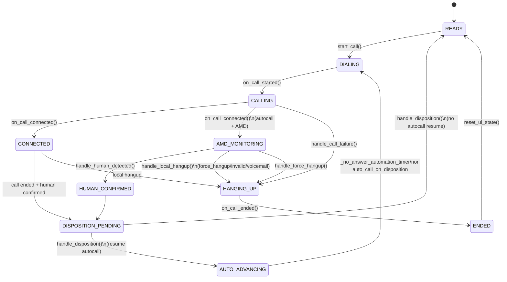

# Client Application — Module Reference

Reference for the Installer app and its modules. See repo root `PROJECT_OVERVIEW.md` for how the client fits in the full system.

## 1. main.py

Everything starts here: the UI, the wiring between components, and the core call/session flow.

- PyQt6 `QMainWindow` subclass (`TeamsPowerDialerApp`) that **owns UI and wiring**, not all state.
- Delegates call lifecycle to `CallWorkflowManager` / `CallSession`:
  - `workflow_manager: CallWorkflowManager`
  - `session: CallSession` (via `TeamsPowerDialerApp.session` and proxy properties like `call_status`, `is_autocalling_active`, `current_call_id`).
- Initializes:
  - Excel reader (`ActiveExcelReader`)
  - Teams controller (`TeamsController`)
  - Audio capture (`AudioCapture`)
  - Streamer (`AudioStreamer` + `StreamerWorker`)
  - Disposition saver (`DispositionSaver`)
  - Settings/session/filter managers
  - Client-side AI (`AMDDetector` + `AMDWorker`)
  - Excel import worker (`ExcelImportWorker` in a `QThread`)
- Uses `sys.coinit_flags = 2` before imports to avoid COM error 0x80010106.
- Runs background threads:
  - `AudioWorker` (capture → queue, AMD input)
  - `StreamerWorker` (queue → server)
  - `DialingWorker` (Teams automation)
  - `AMDWorker` (client-side AI per call)
  - Excel import worker thread for non-blocking Excel reads.

### Key Classes & Functions

- `OverlayHighlight`, `AudioWorker`, `StreamerWorker`, `DialingWorker`, `AMDWorker`
- `DebugQueueDialog`, `SettingsDialog`, `CampaignDialog`, `FiltersDialog`
- `TeamsPowerDialerApp`
- `CallWorkflowManager`, `CallSession`, `CallSessionState`
- `QtMessageDispatcher`

### Watch out for

- COM init: `sys.coinit_flags = 2` must run before any other imports or Excel COM will fail.
- Streamer vs workers: `StreamerWorker` only starts/stops audio streaming; the WebSocket connection is long-lived and started at app startup.
- Call state: Use `CallWorkflowManager` / `CallSession` instead of scattering booleans on the window; UI helpers proxy into `session`.

---

## 2. config.py (Installer root)

Holds server URLs, audio settings, OneDrive path, and other constants. Paths, `SERVER_URL`, `SERVER_API_URL`. `_detect_onedrive_path()` for OneDrive folder.

---

## 3. launcher.py

Checks for updates from the update server, downloads and extracts if newer, then starts `main.py`. Reads `local_version.json`, fetches from `UPDATE_URL`; extracts skipping `PROTECTED_FILES`; runs pip install; launches `main.py`.

**PROTECTED_FILES** (not overwritten on update): `user_settings.json`, `session_history.json`, `teams_dialer.db`, `client_history.db`, `config.py`.

---

## 4–16. modules (summary)

| Module | Purpose |
|--------|---------|
| `active_data_reader.py` | Excel COM → contacts; `load_data_shadow_copy`, `process_contacts`, used by Excel worker. |
| `audio_core.py` | Mic + loopback capture, 48 kHz stereo [mic, loopback]. |
| `streamer.py` | WebSocket to Backend; audio + JSON; pushes inbound messages to a queue and optional `QtMessageDispatcher`. |
| `teams_auto.py` | Teams dialing; pywinauto "Call" button, call window monitor (object-based UIA). |
| `disposition_manager.py` | Save to source `_DISPO_STAMP` + per-disposition Excel files; autosave; Wrong Number delete + undo helpers. |
| `ai_core.py` | Client-side AMD (Silero VAD + faster-whisper, phrase lists, intent detection, shared VAD + Whisper). |
| `campaign_manager.py` | FRESH/RECYCLE/TARGETED/ALL filter. |
| `filter_manager.py` | State/Industry/Time filters. |
| `settings_manager.py` | `user_settings.json`. |
| `session_manager.py` | `session_history.json`. |
| `data_handler.py` | Thin wrapper over reader (kept for compatibility; main code uses `ActiveExcelReader` directly or via worker). |
| `excel_import_worker.py` | Background Excel import (`ExcelImportWorker` + COM init per thread, returns only plain data). |
| `call_state.py` | `CallSessionState` enum (IDLE, READY, DIALING, CONNECTED, AMD_MONITORING, etc.). |
| `call_session.py` | `CallSession` dataclass, single source of truth for call/session state. |
| `call_workflow_manager.py` | `CallWorkflowManager` orchestrates all state transitions and call/session metadata. |
| `message_dispatcher.py` | `QtMessageDispatcher` to re-emit websocket messages as Qt signals on the main thread. |

---

## Quick Reference: Data Flow

```
Excel → ExcelImportWorker (`ActiveExcelReader` inside worker) → `process_contacts` → contact_list
User clicks Call / Autocall → TeamsController.start_call()
Call starts → AudioWorker
  ├─ loopback → AMDWorker (client-side AI: Silero VAD + faster-whisper) → human/voicemail/bot/invalid-number decision
  └─ audio_queue → StreamerWorker → AudioStreamer → Server (for dashboard/monitoring only)
Call ends → handle_disposition → DispositionSaver → source + Dispositions/*.xlsx
```

### Call Session State Snapshot

For deeper debugging, the current call lifecycle is captured in `CallSessionState` managed by `CallWorkflowManager`:


